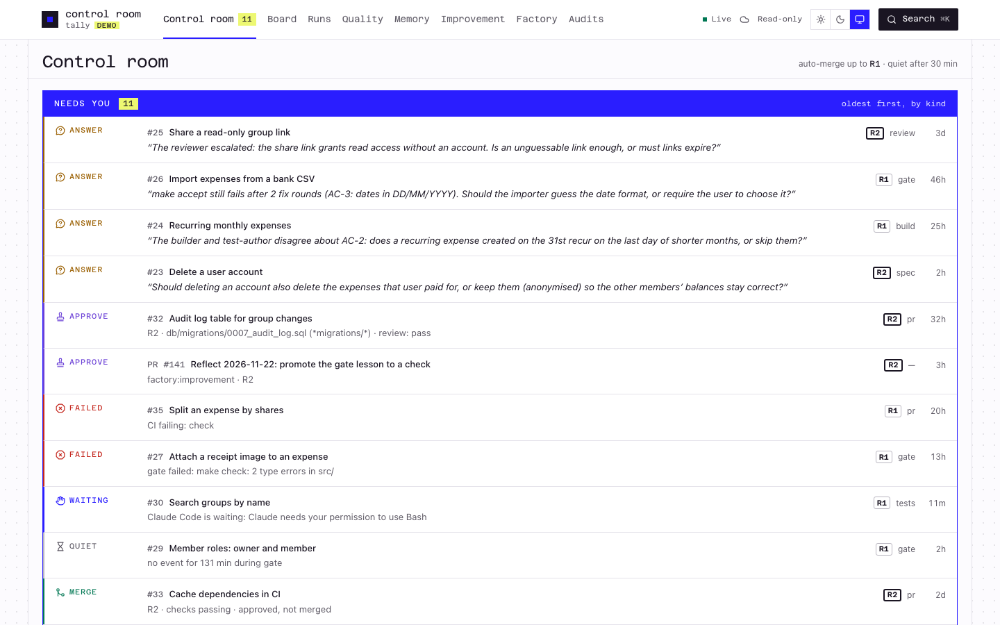
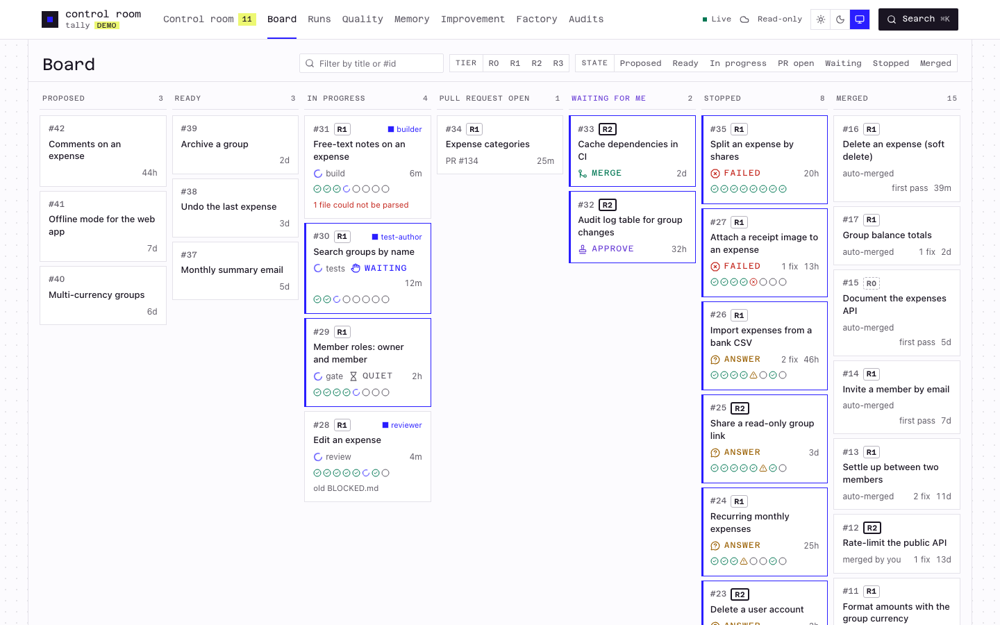
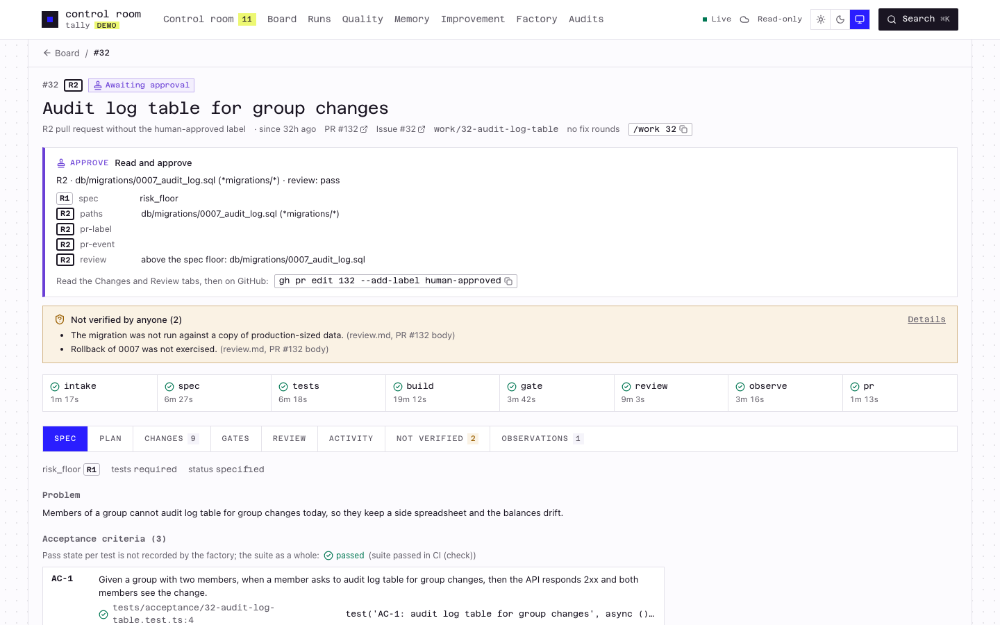
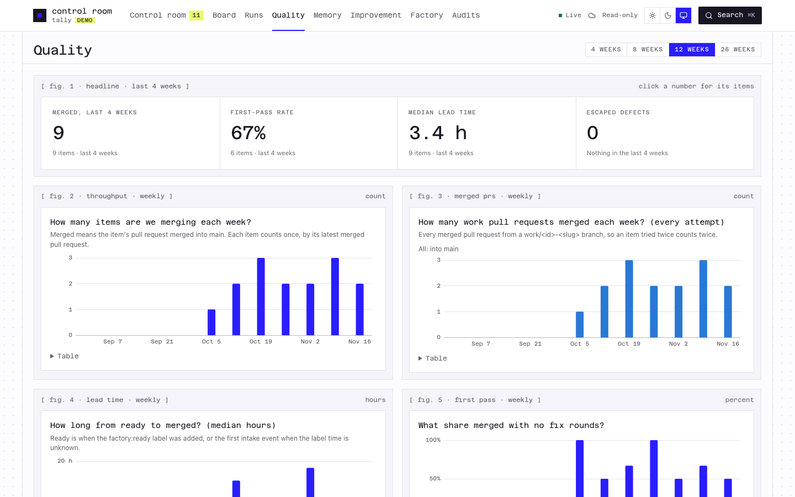
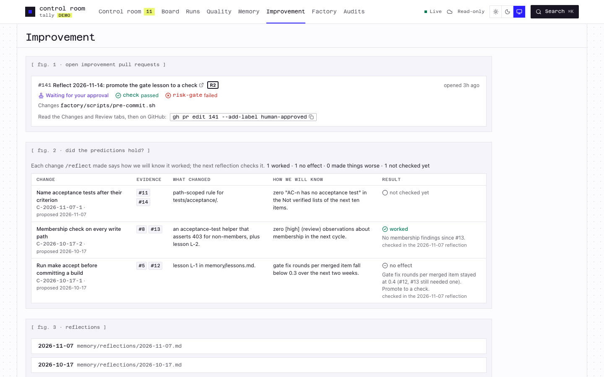
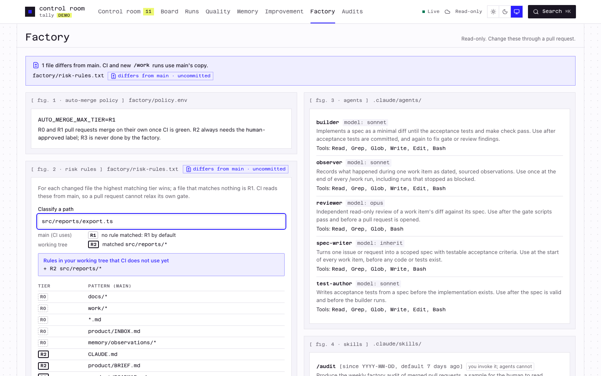
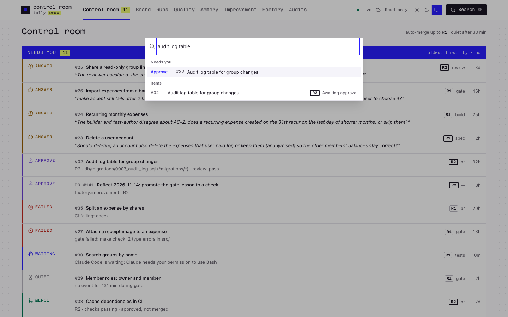
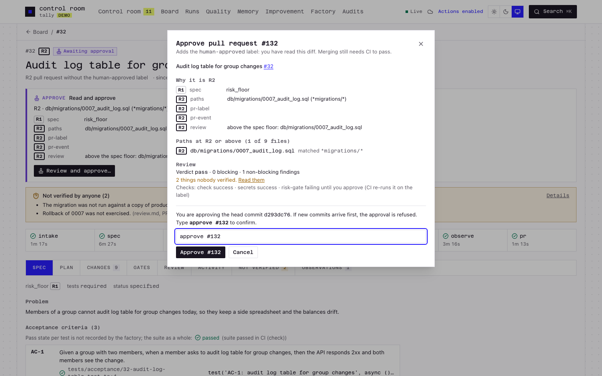

# Control room

A local web app for an agentic software factory built from the
[factory-starter](../factory-starter) kit. It reads the factory's repository, its
GitHub issues and pull requests, and Claude Code's transcripts, and answers three
questions, in this order:

1. **What needs me?** Blocked runs and their question, R2 pull requests waiting for
   approval, failed runs, runs that went quiet, Claude Code waiting at a prompt.
2. **Can I trust what merged?** For each item: the spec, a test per acceptance
   criterion, the gates, the review, the fix rounds, and what nobody verified.
3. **Is the factory getting better?** Throughput, first-pass rate, fix rounds by
   stage, escaped defects, and whether `/reflect`'s predictions held.

It runs on your machine only (127.0.0.1), has no accounts and sends nothing
anywhere. It is read-only unless you start it with `--actions`.



## Start

Needs Node 24 or later (tested on 26) and git. `gh`, logged in, is optional; without
it the app shows local state and says GitHub data is unavailable.

```sh
npm install
npm start -- ~/code/my-factory            # a factory repo
npm run demo                               # a generated demo factory, 36 items in every state
```

It prints the address (port 4317, or the next free one). The web app is built on
first start, and again whenever its sources change. `npm link` adds a
`control-room <path>` command.

| Option | |
|---|---|
| `--demo` | generate a demo factory in `~/.control-room/demo` (replaced on every start) |
| `--actions` | allow changes: mark an issue ready, approve an R2 pull request, answer a blocked question |
| `--port N` | preferred port on 127.0.0.1 (default 4317) |
| `--stale-minutes N` | a running item with no event for N minutes "needs you" (default 30) |
| `--offline` | never call GitHub; show cached GitHub data, marked stale |
| `--github-interval S` | seconds between GitHub refreshes (default 60) |
| `--data-dir DIR` | where the cache and action log live (default `~/.control-room/<repo>-<hash>`; safe to delete) |
| `--print` | print the derived board and exit |
| `--open` | open the browser |

## Screens

**Control room**: what needs you, ordered: answer, approve, failed, waiting, quiet,
merge. Oldest first within each. Below that: what is running now and what merged.

**Board**: Proposed, Ready, In progress, Pull request open, Waiting for me, Stopped,
Merged. Filters for tier and state live in the URL.



**Item**: a stage timeline, then Spec (each acceptance criterion with the tests that
name it), Plan, Changes (each file with its risk rule), Gates, Review, Activity
(every event and agent run, with model and tokens), Not verified, Observations.
A file that cannot be parsed shows a notice and its raw text.



**Runs**: every agent run, live and finished, with model, duration, the stage's
result and tokens. Open runs with no recent event are marked quiet.

**Quality**: one chart per question, by week. Every tile, bar, segment and table cell
opens the items behind it.



**Memory**: lessons with links to their evidence, every observation (searchable), and
observation counts by stage and week.

**Improvement**: open `factory:improvement` pull requests, and every change `/reflect`
made with its prediction and what the next reflection found.



**Factory**: policy, risk rules (with a "classify a path" box), agents, skills, hooks
and permissions. A file that differs from `main`, uncommitted or committed on the
checked-out branch, is flagged, because CI and new runs use `main`'s copy.



**Audits**: the weekly `/audit` reports, newest first.

**Team mode** (a factory with `factory/teams.json`, see the kit's `docs/factory/TEAMS.md`). The
control room adds a **Teams** table: each team's Herdr session (state and message), its worktree's
branch and the work item it holds. **Planning** (`g p`) shows the planning cycle (status, how long
in it, who still owes a position, answer or accept, the decision records, the pull request, the
transcript and the planning events) and each feature (its branches, its issues by team with where
each is, and its acceptance criteria, e2e report and acceptance review). Needs you adds: a work
item stopped in a team worktree (its `BLOCKED.md`, committed or not), a brief or decisions waiting
for your label or merge, each `needs-human` decision record, a stopped meeting, and a session in
Herdr's `error` or `blocked` (dialog) state. Team mode's own events are not notices; an
`escalation` from the sweep is one, in its own words.

Light and dark themes follow the system; switch in the top bar or the palette. The look follows Warp's factory pages: Azeret Mono for structure, hairlines, square corners and figure frames.

## Keyboard

| | |
|---|---|
| ⌘K / Ctrl+K | command palette: items, screens, commands |
| `g` then `r` `b` `u` `q` `m` `i` `f` `a` `p` | go to a screen |
| `j` / `k`, Enter | move through the page's list, open |
| `/` | focus the page's filter |
| ← → in a chart | move between weeks; Enter lists the items |
| `?` | all shortcuts |



## Where the data comes from

| Source | Read for |
|---|---|
| `work/<id>-<slug>/` on the working tree, every `work/*` branch and `main` | spec, plan, review, BLOCKED.md, log (newest copy wins: working tree, then branch, then main) |
| `.factory/events.jsonl` and each item's `events.jsonl` | stage events, agent and session lifecycle |
| `tests/acceptance/<id>-*` | which test names which criterion |
| `memory/`, `docs/factory/audits/`, `.claude/`, `factory/`, `CLAUDE.md` | memory, reflections, audits, configuration |
| git history of `main` | merges, squash commits, reverts. `git fetch origin` runs with every GitHub refresh, so work done on GitHub (the factory workflow) shows up; it updates only remote-tracking branches |
| `gh` (GraphQL) | issues, labels and their times, pull requests, checks, files, auto-merge |
| team mode: `factory/teams.json` (main, else the working tree), `git worktree list` (`../<repo>.teams/<team>`) | teams, what each owns, each team's checkout; a team worktree on `work/<id>-<slug>` is read like the main checkout for that item |
| team mode: `planning/<cycle>/` | the cycle named by `.factory/planning/active`, else the newest; read from the working tree, its `planning/` branch, the feature branch and main, whichever copy's `state.json` history is longest. Sealed positions are only checked to exist, never read |
| team mode: `feature/<f>`, `integrate/<f>` (origin first) and issues labelled `feature:<f>` | features, their records and items |
| team mode, optional: `herdr-app ls`, `hc get <terminal> --json` | each team session's state. Only the space named after the repo folder is kept; every other space, tab and terminal is dropped unread. Never `hc send` or `keys`. Without them: "sessions unavailable" |
| `~/.claude/projects/**` | model and tokens per run. The format is not a stable interface: only files under that folder are read, lines are de-duplicated, and token figures are hidden when nothing can be read |

Everything is derived again from these files on every change (a full read takes
about 0.3 s for 1,000 items and 15,000 events); the SQLite file in the data folder
only caches GitHub data and transcript totals. Changes appear within a second or two
without a refresh. When GitHub cannot be reached, the app shows the cached data with
its fetch time and says it is stale.

Nothing is inferred from prose. Where the factory does not record something the
screens need, the app says so, and [docs/DESIGN.md §10](docs/DESIGN.md) lists the
proposed changes to the factory's data contract.

## Security

- Binds to 127.0.0.1. Requests for any other `Host` are refused (DNS rebinding).
- Everything shown was written by an agent or by whoever filed the issue, so it is
  untrusted. Markdown is rendered without raw HTML (it is shown as code), images are
  never loaded, only http(s) and mailto links work, and nothing in the content is
  acted on. A strict Content-Security-Policy backs this up.
- Files are served from a fixed list built at start, so there is no path traversal.
  Diffs and factory files are served only for paths the app itself listed.
- `git` and `gh` are always called with argument arrays, never through a shell.
  Free text (an answer) goes to `gh` on stdin.
- Without `--actions`, nothing that can change anything is even constructed, and
  every non-GET request is refused. The tests prove it.
- With `--actions`, every change needs the same Origin, `Sec-Fetch-Site:
  same-origin`, the per-launch token from the page, and a JSON body. The input
  must match a strict schema. Approval also needs the typed confirmation, and it
  is refused if the pull request's head moved since you looked. Every attempt,
  refused or not, is appended to `actions.jsonl` in the data folder.



## Develop

```sh
npm run typecheck     # server and web
npm test              # parsers, state derivation, quality, actions, server (vitest)
npm run test:e2e      # every screen in a browser, axe in both themes, actions, performance at scale
npm run dev           # rebuild the web app on change; restart with CONTROL_ROOM_DEV=1 to serve it fresh
```

`server/core/` is pure (parsers, derivation, quality, views) and shared with the web
app. `server/sources/` reads git, GitHub, transcripts and the factory's files.
`server/actions.ts` is every change the app can make. `web/` is React, Vite and
Tailwind. `demo/generate.ts` builds the demo factory (a real git repo);
`demo/scale.ts` adds thousands of rows for the performance test.

## Not verified

- Against a real factory repository with real pull requests: only the demo and an
  empty factory-starter checkout were used. The GraphQL queries were checked
  against a public repository.
- Actions against real GitHub: the tests use the demo's GitHub file and a fake
  `gh`. The first real use is recorded in `actions.jsonl`.
- Token figures from real Claude Code transcripts: the reader was written against
  the documented format and synthetic files.
- Windows (line endings would make every local factory file look changed).
- Team mode was checked against one real factory, with one cycle (dispatched) and one feature;
  the brief, positions, discussion and escalated states only against the test fixture. Herdr
  states were seen as `idle`, `working` and `done`; `error`, `blocked` and `.status.msg` only from
  the fake `hc`. Team worktrees and Herdr are outside the watched folder, so their changes appear
  within 30 seconds (the clock), not at once.
